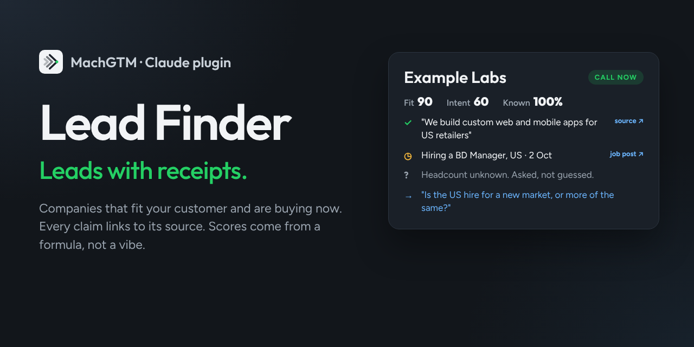
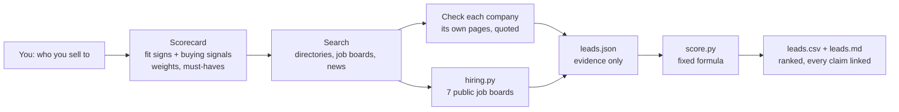

<p align="center">
  
</p>

<p align="center">
  <a href="https://github.com/machgtm/lead-finder/actions/workflows/test.yml"></a>
  
  
  <a href="LICENSE"></a>
</p>

# Lead Finder: leads with receipts

Tell Claude who you sell to. Get back the companies that **fit** and are **buying right now**, ranked, with a link behind every claim.

- **Facts** come with a source and an exact quote.
- **Guesses** are written as questions.
- **Unknowns** stay unknown and count neither for nor against a company.

The scores come from a small script with a fixed formula, not from the model's mood, so the same evidence always gives the same score.

<p align="center">
  
</p>

## Install in 30 seconds

**Claude Code**

```
/plugin marketplace add machgtm/lead-finder
/plugin install lead-finder@machgtm
```

**Claude desktop, web and Cowork**: Customize › Plugins › Add › Add marketplace › `machgtm/lead-finder`.

**Codex**: the skills follow the open Agent Skills format. Install each one from its GitHub folder:

```
$skill-installer install https://github.com/MachGTM/lead-finder/tree/main/skills/find-leads
$skill-installer install https://github.com/MachGTM/lead-finder/tree/main/skills/check-receipts
```

Then just ask:

> Find 25 leads. I sell a security review to B2B SaaS companies with 20 to 200 people in Europe. Must-have: sells to enterprises. Buying signals: hiring a first security engineer, recent funding.

No API keys, no paid data, no sign-up. It runs on your own Claude.

## Why it exists

AI prospecting tools are very good at sounding sure. Watch what happens to a fact on its way into a typical lead list:

| What was true | What the AI tool said | What Lead Finder says |
|---|---|---|
| They posted three engineering jobs | "Struggling with capacity" | **Hiring**: 3 engineering roles, posted 2 Oct, with the link |
| A blog post mentions a second office "some day" | "Expanding into Europe" | **Unknown**: no date. Ask: "Is the London office happening this year?" |
| No headcount anywhere on their site | "200 employees" | **Unknown**: headcount. Counted neither for nor against them |
| They raised money in 2024 | "Recently funded" | **Too old to count**: outside the 180-day window |

Buyers notice confident guesses. A list with receipts lets you write to people about things that are actually true.

## What you get

For every company:

| | |
|---|---|
| **Priority** | Call now · Qualify · Nurture · Skip |
| **Fit** | each of your fit signs: met, not met or unknown, with the quote and the page |
| **Why now** | dated buying signals: hiring for sales roles, funding, a new office, a new sales leader |
| **Must-haves** | a company that clearly fails a deal-breaker (say, too big) is skipped, whatever else it scores |
| **Open questions** | what couldn't be confirmed, phrased so you can ask it |
| **First question** | one opener built only from a sourced fact |

Saved as `leads.csv` for your CRM or sheet, and `leads.md` to read and share.

Hiring is checked live on seven public job boards (Greenhouse, Lever, Ashby, SmartRecruiters, Recruitee, Breezy HR and Personio), so "hiring a BD manager" comes with the post and its date.

## Check any email for receipts

New in 1.1: paste a cold email and ask Claude to check it.

> Check this email for receipts: ...

Claude finds every claim, looks for a public page that backs it, and turns the rest into questions or takes them out. A small script scores it against the [Receipts Standard](https://github.com/MachGTM/receipts/blob/main/STANDARD.md): "Receipts: 4 of 6 claims (67)". You get a table of claims and sources, and a rewritten email with footnotes. It won't invent a source to make the email pass.

Want a quick check without Claude? The [receipts check](https://machgtm.github.io/receipts/check/) does a pattern check in your browser.

## How it works



Claude does the reading. The scripts do the maths.

## The formula

| Score | How it's worked out |
|---|---|
| **Fit** | weight of signs met ÷ weight of signs known, 0–100. Unknown signs count neither way. |
| **Coverage** | weight of signs known ÷ all signs. Below 50%, fit is unproven: the company can only be Qualify or Skip. |
| **Intent** | each signal type counts once, at its freshest: weight × recency, summed, ÷ total signal weight. Recency: 0–30 days ×1, 31–90 ×0.6, 91–180 ×0.3, older ×0. |
| **Priority** | Call now: fit ≥ 60 and intent ≥ 30. Nurture: fit ≥ 60, no recent signal. Qualify: a signal but fit unproven. Skip: the rest, or a failed must-have. |

Every rule is in [skills/find-leads/reference/scorecard.md](skills/find-leads/reference/scorecard.md), and the script is about 300 lines of plain Python you can read in ten minutes.

## Ground rules

- Public pages only. No LinkedIn scraping, nothing behind a login.
- Companies and roles, never personal emails or phone numbers.
- Everything dated, so you know how fresh it is.
- If fewer companies survive checking than you asked for, it tells you instead of padding the list.

## What it connects to

There is no Lead Finder server, and nothing is sent to MachGTM. Everything runs in your own Claude session.

| Connection | What for | What is sent |
|---|---|---|
| Claude's web search and web fetch | Finding companies and reading their own pages, careers pages and news | Your search queries and the pages Claude opens |
| Seven public job-board APIs (read-only, no key): Greenhouse, Lever, Ashby, SmartRecruiters, Recruitee, Breezy HR, Personio | `hiring.py` checks open roles and the date each was posted | A guessed board name per company (for example `acme`), with the user agent `lead-finder/1.0 (+https://machgtm.com)` |
| Your disk | Writing `leads.json`, `leads.csv`, `leads.md`, `receipts.json` and `receipts.md` | Nothing |

No API keys, no logins, no cookies, no analytics. Every endpoint is in [hiring.py](skills/find-leads/scripts/hiring.py), and each skill can only run the scripts in its own folder.

## FAQ

**Does it send emails?** No. It finds and ranks companies and suggests a first question. What you send is up to you.

**What does it cost?** Nothing. It uses your existing Claude plan; there's no paid data source behind it.

**Why not just ask Claude for a lead list?** You can, and you'll get a confident list. You won't know which lines are facts, which are guesses and which are made up. Here each line has a link, and the ranking is a formula you can check.

**My buyers don't use those job boards.** Then hiring is marked unknown, not "not hiring", and Claude reads their careers page and the news instead. Job-board coverage is strongest for US and European companies; many smaller firms in India and elsewhere use hiring systems with no public feed.

**Can I bring my own list?** Yes: "Check whether these 40 companies fit my customer" works the same way.

## Run the scripts on their own

Python 3.10 or newer, standard library only.

```
python3 skills/find-leads/scripts/hiring.py "Acme Labs" acme.io --keywords "sales,business development" --days 180 --signal-id hiring_bd
python3 skills/find-leads/scripts/score.py leads.json
python3 skills/check-receipts/scripts/receipts.py receipts.json
```

## Tests

```
python3 -m unittest discover -s tests -v
```

60 tests, including responses recorded from all seven job boards. A weekly CI job calls the live boards to catch API changes.

## From a list to meetings

Lead Finder is an open-source project from [MachGTM](https://machgtm.com). Mach is an AI sales teammate — an AI SDR — for B2B teams that sell software and software services. It learns what you sell, researches the companies you bring, writes what to say, reads every reply and books the meeting. A person approves everything that goes out.

Lead Finder gives you a list to work yourself. Mach works it with you: it watches for new signals every week, finds the people to talk to at each company, and writes each message with the source next to every claim.

## Contributing

Issues and pull requests are welcome, especially new public job boards, better discovery sources for a market, and scorecard examples for other industries. Please keep the scripts dependency-free and add a recorded response to `tests/fixtures/` for anything that calls an API.

## License

MIT. See [LICENSE](LICENSE).
